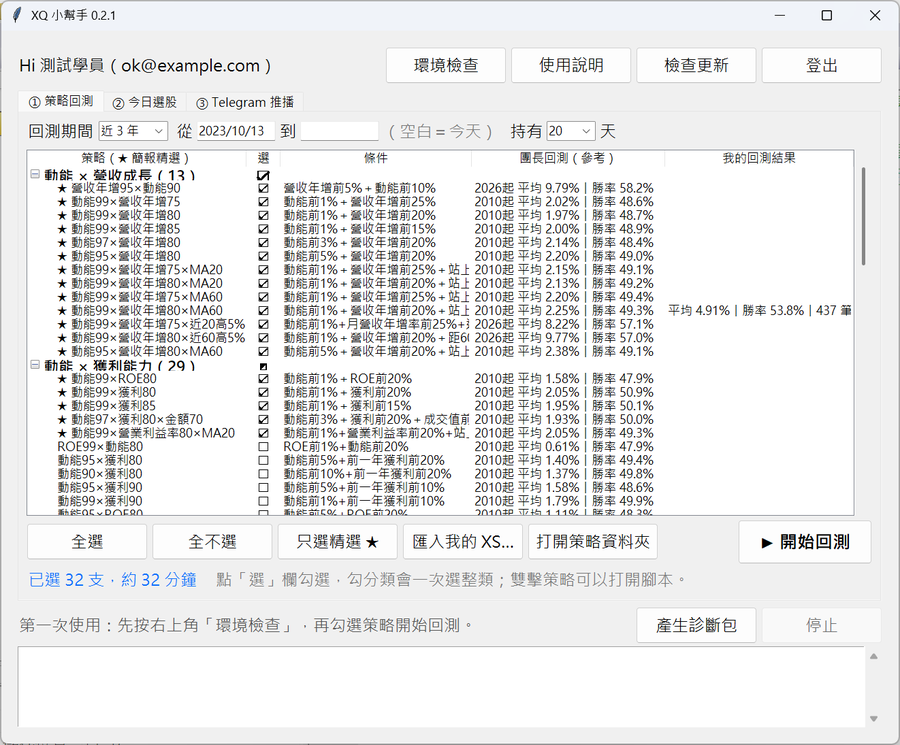
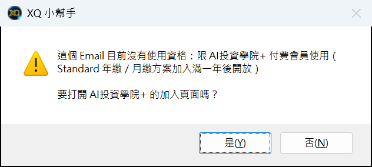
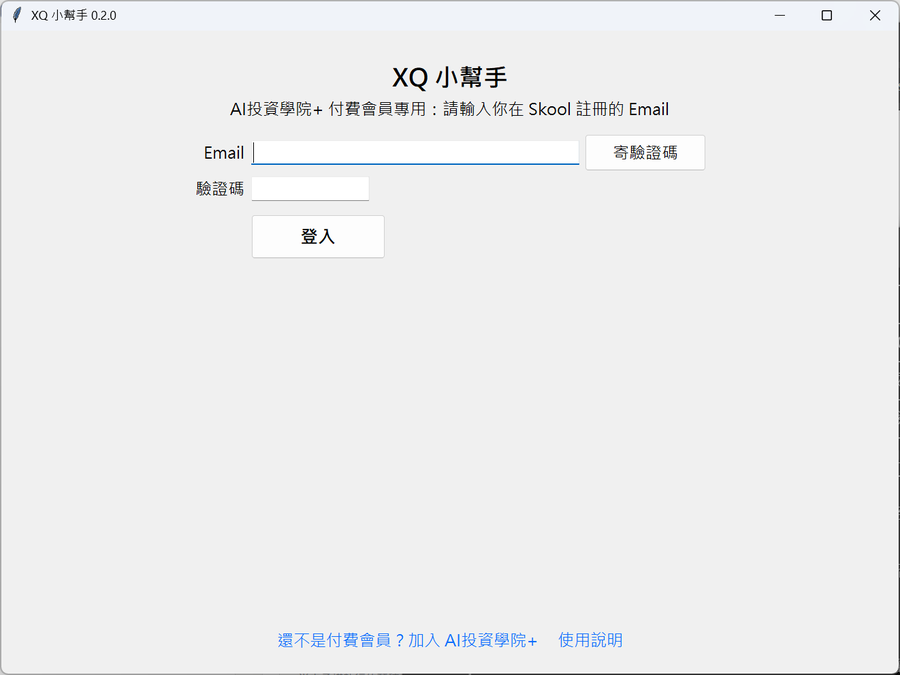
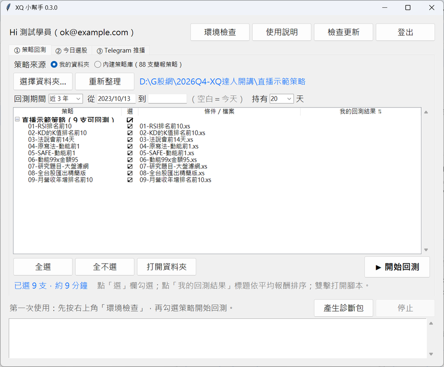
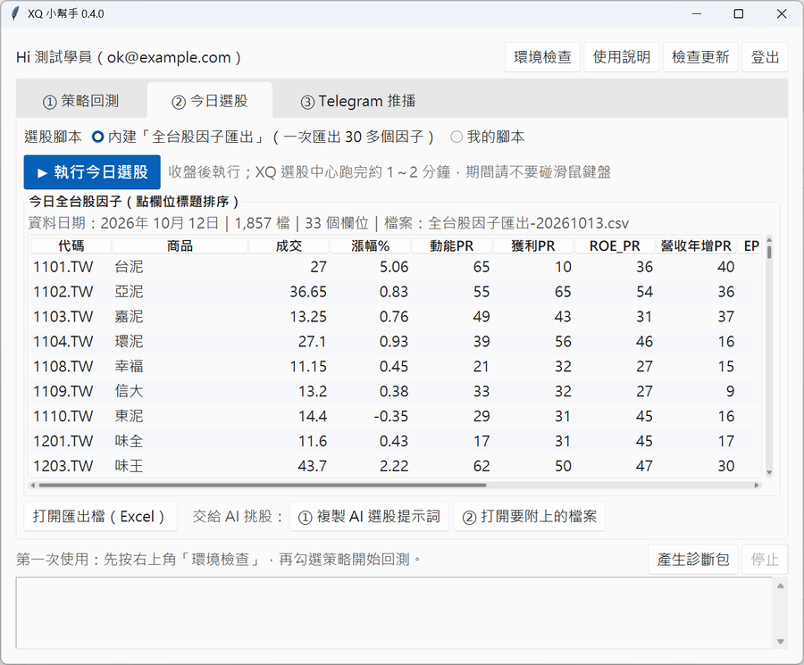
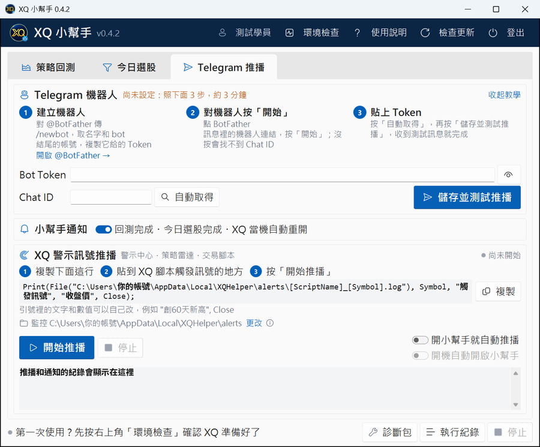

# XQ 小幫手 使用說明

XQ 小幫手是給 **XQ 全球贏家**使用者的 Windows 桌面工具：**選一個放 XS 腳本的資料夾就能一鍵批次回測**，也內建 **2,162 支選股策略**（XQ達人開講簡報的 1,685 支單一因子＋多因子組合）；收盤後**匯出今日全台股**交給 AI 挑股；XQ 策略訊號還能**推播到 Telegram**。
不用安裝 Python，也不用寫程式，連一支策略都沒有也能馬上開始。

> ⚠️ **AI投資學院+ 付費會員專屬工具**：必須用付費會員的 Skool Email 登入才能使用。
> 僅供研究與教育，不構成投資建議；回測結果不代表未來績效，投資請自行判斷並承擔風險。



## 目錄

- [使用資格](#使用資格)
- [功能一覽](#功能一覽)
- [系統需求](#系統需求)
- [一、安裝](#一安裝)
- [二、登入](#二登入)
- [三、開始前準備](#三開始前準備)
- [四、策略回測](#四策略回測)
- [五、今日選股](#五今日選股)
- [六、Telegram 推播](#六telegram-推播)
- [七、更新](#七更新)
- [八、常見問題](#八常見問題)
- [九、移除](#九移除)
- [隱私與資料](#隱私與資料)
- [使用條款](#使用條款)

## 使用資格

XQ 小幫手限 **AI投資學院+（Skool）付費會員**使用，用你在 Skool 註冊的 Email 登入：

| 方案 | 什麼時候可以用 |
|---|---|
| Premium、VIP | 立即可用 |
| Standard 一次付清 | 立即可用 |
| Standard 年繳／月繳 | 加入滿一年後開放 |

- 不符合資格的 Email 登入時會跳出提示，可以直接開啟加入頁面。
- 小幫手每次開啟、以及開著時每 6 小時會向伺服器確認一次資格；**退訂後就無法繼續使用**（沒有網路時最多寬限 7 天）。
- 還不是會員？👉 [加入 AI投資學院+](https://www.skool.com/ai-investment-academy-plus)



## 功能一覽

| 功能 | 說明 |
|---|---|
| ① 策略回測 | 選一個放 XS 的資料夾，或從內建 2,162 支簡報策略（5 大類＋多因子組合，可搜尋）勾選，一鍵批次回測；可以自訂回測期間（預設近 3 年）與持有天數（預設 20 天）。XQ 當機會自動重開接著跑，結果直接顯示並排序 |
| ② 今日選股 | 收盤後一鍵在 XQ 選股中心執行「全台股因子匯出」，匯出今天全部台股 30 多個因子並直接預覽，再複製 AI 選股提示詞，讓 AI 依回測成績挑出前 5 檔（也可以改用自己的匯出腳本） |
| ③ Telegram 推播 | XQ 策略觸發訊號時即時推到你的 Telegram；回測、匯出跑完或 XQ 當機重開也會通知你 |
| 環境檢查 | 右上角按鈕：執行前確認 XQ 已安裝、設定正確，有問題會告訴你怎麼改 |
| 自動更新 | 有新版會跳出提示，一鍵更新；每個版本都有數位簽章，驗證通過才會安裝 |

## 系統需求

- Windows 10 / 11
- 已安裝並能登入的 XQ 全球贏家，帳號有「選股中心」與「選股回測」功能
- 網路連線（登入、確認會員資格、Telegram 推播需要）
- Telegram 推播：一個 Telegram 帳號（免費）

## 一、安裝

1. 到 [下載頁面](https://github.com/GsirGinRay/xq-helper-releases/releases/latest) 下載 `XQHelper-Setup-版本.exe`，雙擊執行。
   頁面上的「Source code」是 GitHub 自動附上的，不用下載。
2. 如果出現藍色視窗「**Windows 已保護您的電腦**」：
   1. 按左邊的「**其他資訊**」
   2. 再按出現的「**仍要執行**」

   （這是因為小幫手沒有向微軟購買程式簽章，不是病毒。）
3. 安裝會自動進行，大約 10 秒，完成後自動開啟小幫手。
4. 桌面會多一個「XQ 小幫手」捷徑，之後從這裡開。

不需要系統管理員權限；程式裝在你自己的使用者資料夾。

## 二、登入

1. 輸入 Skool 的 Email → 按「**寄驗證碼**」。
2. 到信箱收「[XQ 小幫手] 您的登入驗證碼」（沒收到請看垃圾郵件匣）。
3. 輸入 6 位數驗證碼 → 按「**登入**」。

登入一次可以用 30 天，到期再收一次驗證碼就好。



## 三、開始前準備

- 第一次手動登入 XQ 時，勾選「**記住帳號**」「**記住密碼**」（小幫手才能在 XQ 當掉時自動重新登入）。
- **關掉全螢幕的遊戲或影片**；小幫手執行匯出或回測時**不要碰滑鼠鍵盤**，XQ 會自己動。

## 四、策略回測


最上面的「**策略來源**」有兩種：

| 來源 | 適合 |
|---|---|
| **我的資料夾** | 已經有自己的 XS 選股腳本，例如 AI x XQ 課程中請 AI 產生的策略 |
| **內建策略庫** | 還沒有策略：直接用 XQ達人開講簡報的 2,162 支選股策略（技術面、籌碼面、基本面、事件類、其他 5 大類共 1,685 支單一因子，加上多因子組合），附團長回測成績 |

### 用我的資料夾批次回測（最常用）



1. 把要回測的 `.xs` 選股腳本放進同一個資料夾（子資料夾裡的也會一起找到）。
2. 選「**我的資料夾**」→ 按「**選擇資料夾…**」選那個資料夾，裡面的腳本會全部列出並自動勾選。
   - 交易、警示腳本不能批次回測，會以灰字顯示原因並略過。
   - 之後又放了新的腳本，按「**重新整理**」就會加進來（新的自動勾選）；腳本內容改過，下次回測會自動重跑那一支。
3. 設定回測期間與持有天數（見下方），按「**▶ 開始回測**」。
4. 跑完表格會自動依平均報酬排序，最好的那支標成綠色；點「我的回測結果」標題可以切換排序。

### 用內建策略庫

選「**內建策略庫**」：表格依「大類／細類」列出 2,162 支策略，★ 是簡報精選（第一次預設勾選這 32 支）。

- 右上角的**搜尋框**可以打關鍵字，例如「營收」「外資」「RSI」，只顯示相關策略；搜尋時按「全選」只會勾搜尋到的。

- 點策略那一列就能勾選或取消；點分類前面的勾選框會一次選整類；「全選」「全不選」「只選精選 ★」可以快速切換。
- 「條件」欄是選股條件；「團長回測」是簡報裡的回測成績，給你參考。
- 雙擊策略可以打開腳本看程式碼。

### 回測期間與持有天數

- 回測期間：近 1／2／3／5 年或自訂起訖日（結束日空白代表今天），預設**近 3 年**。
- 持有：買進後持有幾天再賣出，預設 **20 天**，也可以直接輸入其他天數。
- 每支約 1 分鐘，下方會顯示進度。期間 XQ 會自己操作，**不要碰滑鼠鍵盤**；中途可以按「停止」。

小提醒：

- 用同樣的設定再按一次「開始回測」，已經跑完的會自動略過，只跑還沒跑的。
- 換了期間或持有天數，結果會另外存放，不會和舊的混在一起；換回原本的設定，舊結果也還在。
- 第一次使用前，先按右上角「**環境檢查**」。

### 匯入個別腳本到內建策略庫

在內建策略庫模式按「**匯入我的 XS…**」，選一個或多個 `.xs` 檔（XQ 選股腳本，可以從 XQ 的 XScript 編輯器另存）。
小幫手會自動編號並放進「我的策略」分類、自動勾選；格式不用自己調整。交易或警示腳本不能批次回測，會提示略過。

## 五、今日選股



1. 「選股腳本」用預設的內建「**全台股因子匯出**」（FACTOR-EXPORT，一次匯出 30 多個因子：動能、獲利、ROE、營收年增、EPS、成交值、外資、投信、產業等）。
2. 收盤後按「**▶ 執行今日選股**」：小幫手會在 XQ 選股中心執行這支腳本，匯出今天全部台股（約 1,850 檔）的因子數值，大約 1～2 分鐘。第一次使用會自動把腳本匯入 XQ、建立選股策略。
3. 跑完下方直接顯示「**今日全台股因子**」表格，點欄位標題可以排序（例如依動能PR由高到低）；按「打開匯出檔（Excel）」看完整資料。
4. **交給 AI 挑股**：按「① 複製 AI 選股提示詞」貼到 ChatGPT、Claude 或 Gemini，再按「② 打開要附上的檔案」，把「回測精華.csv」和今天的「全台股因子匯出-日期.csv」一起附上，AI 就會依回測成績挑出前 5 檔。

進階：「選股腳本」選「**我的腳本**」可以改用自己寫的匯出腳本（例如課程中請 AI 產生的，用 OutputField 輸出想看的欄位），按「選擇 .xs…」選檔案即可。

## 六、Telegram 推播



### 第一次設定（約 3 分鐘）

1. 在 Telegram 搜尋 **@BotFather**，傳 `/newbot`，照指示幫 Bot 取名字，最後會拿到一串 **Token**（長得像 `123456789:AA...`），複製起來。
2. 打開你剛建立的 Bot，按「**開始**」（或隨便傳一句話）。
3. 回到小幫手「**Telegram 推播**」分頁：貼上 Token → 按「**自動取得**」（自動填入 Chat ID）→ 按「**儲存並測試推播**」。
4. Telegram 收到「測試推播成功」就完成了。

Token 等於這個 Bot 的密碼，不要給別人；小幫手會加密存在你的電腦。

### 推播 XQ 策略訊號

1. 按分頁上的「**複製**」，把那一行程式碼貼到 XQ 策略腳本中「觸發訊號」的地方，例如：

   ```
   Print(File("C:\Users\你的帳號\AppData\Local\XQHelper\alerts\[ScriptName]_[Symbol].log"), Symbol, "觸發訊號", "收盤價", Close);
   ```

   `[ScriptName]`、`[Symbol]` 會由 XQ 自動換成策略名稱與股票代碼；後面的文字和數值可以自己改。
2. 在小幫手按「**開始推播**」。之後 XQ 每寫出一行新訊號，就會推到你的 Telegram。

小提醒：

- 按「開始推播」時，資料夾裡已經有的舊訊號不會推，只推之後新增的。
- 同一個策略一次寫出多行時會合併成一則訊息（最多 20 行）。
- **小幫手要開著才會推播**。可以勾選「開機時自動開啟小幫手」與「開啟小幫手時自動開始推播」。
- 想監控其他資料夾（例如原本 XQ 寫檔的位置），按「更改」選擇資料夾。

### 系統通知

勾選「回測／匯出跑完、XQ 當機自動重開時也通知我」（預設開啟）後，會收到：

- XQ 當機或沒有回應，正在重新開啟／已重新啟動／修復失敗
- 批次回測完成，附平均報酬前 5 名與 0 筆交易的因子提醒
- 匯出今日全台股完成或失敗

## 七、更新

- 小幫手開啟時會自動檢查新版；有新版會跳出視窗顯示這版更新內容：
  - 「是」：自動下載、驗證、安裝並重新開啟
  - 「否」：這個版本不再提醒
  - 「取消」：下次開啟再說
- 也可以按右上角「**檢查更新**」。
- 每個版本都有數位簽章，驗證不通過就不會安裝。

## 八、常見問題

| 狀況 | 怎麼辦 |
|---|---|
| 收不到驗證碼 | 看垃圾郵件匣；確認是 Skool 註冊的 Email；60 秒後可重寄 |
| 跳出「這個 Email 目前沒有使用資格」 | 確認是付費會員的 Email，以及方案是否已開放（見[使用資格](#使用資格)） |
| 「XQ 視窗切不到最前面」 | 關掉全螢幕的遊戲或影片，執行時不要操作滑鼠鍵盤 |
| 回測一直沒有結果、或結果是 0 筆 | 先按「環境檢查」；確認 XQ 帳號有「選股回測」功能。0 筆代表這段期間沒有股票符合條件，可以拉長回測期間 |
| 「找不到選股中心的工具列」 | 你的 XQ 版本版面不同：按「產生診斷包」傳給團長 |
| 匯出是 0 檔或某些欄位整欄空白 | 按「產生診斷包」傳給團長 |
| 測試推播失敗：Token 不正確 | 到 @BotFather 重新複製 Token（整串都要） |
| 測試推播失敗：找不到 Chat ID | 先在 Telegram 對你的 Bot 按「開始」，再按「自動取得」 |
| 開始推播了但沒收到訊號 | 確認 XQ 腳本裡 `Print(File(...))` 的路徑和分頁上顯示的監控資料夾一樣，且策略真的有觸發 |
| 換電腦 | 新電腦重新安裝、重新登入、重新設定 Telegram 即可 |

## 九、移除

Windows 設定 →「應用程式」→ 找「XQ 小幫手」→ 解除安裝。
你的因子、回測結果和匯出檔會保留在 `%LOCALAPPDATA%\XQHelper`，不想要可以手動刪除。

## 隱私與資料

- 登入資料與 Telegram Token 用 Windows 加密存在你的電腦，只有你自己的 Windows 帳號解得開。
- 因子、回測結果、匯出檔都留在你的電腦（`%LOCALAPPDATA%\XQHelper`），更新或移除程式都不會刪除。
- 小幫手只會把你的 Email 傳給 AI投資學院+ 的伺服器確認會員資格；推播內容只會傳給你自己的 Telegram Bot。

## 使用條款

- 本工具為 AI投資學院+ 付費會員專屬，帳號僅限本人使用，請勿轉借或分享登入。
- 本工具與 XQ 全球贏家（嘉實資訊）無隸屬關係；XQ 的使用請遵守其服務條款。
- 本工具與其產生的資料僅供研究與教育，不構成任何投資建議；使用者應自行判斷並承擔投資風險。
- 有問題請到 AI投資學院+ 社群發問，或用「產生診斷包」把檔案傳給團長。
